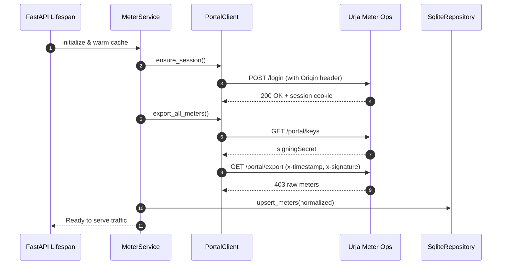
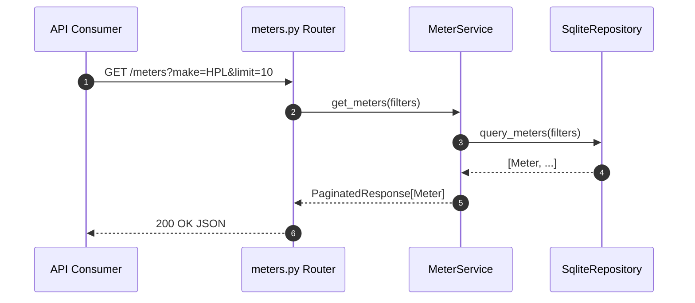
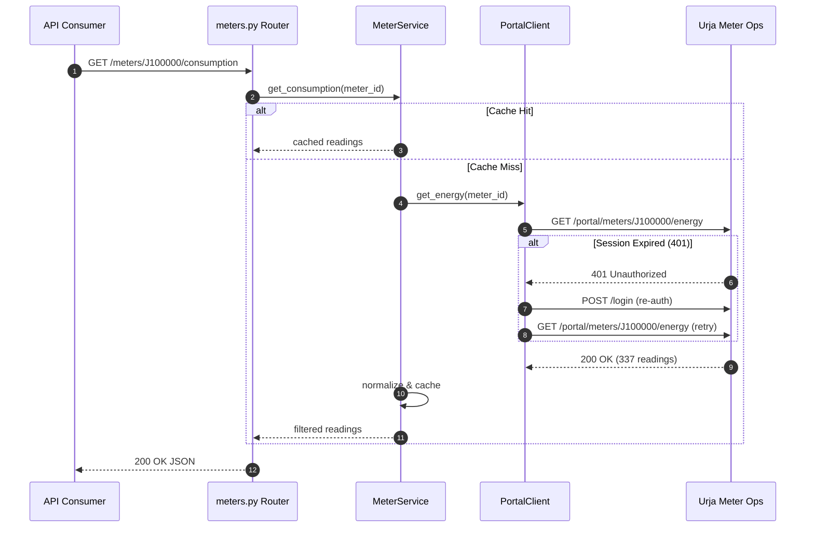

# Code Execution Flow & Architecture

This document describes the request lifecycle, directory layout, and component interactions across the Urja Meter API wrapper service.

---

## 1. Directory Layout & Module Responsibilities

- **`src/config.py`**: Loads environment configuration (`PORTAL_URL`, `PORTAL_USERNAME`, `PORTAL_PASSWORD`, `CACHE_TTL_SECONDS`, etc.) via Pydantic Settings.
- **`src/models/errors.py`**: Defines standard error response schema `{"error": {"code": str, "message": str, "details": optional}}`.
- **`src/models/meter.py`**: Normalized meter representations, phase/status enums, and query filter parameters.
- **`src/models/consumption.py`**: Normalized half-hourly consumption readings, ISO-8601 UTC timestamps, and consumption summaries.
- **`src/models/hierarchy.py`**: Reconstructed network hierarchy models, node relationships, and anomaly report schemas.
- **`src/services/portal_client.py`**: Low-level HTTP client handling SvelteKit login, `better-auth` session token tracking, automatic re-authentication on 401, HMAC SHA-256 signature generation, exponential backoff retries, and timeouts.
- **`src/services/normalizer.py`**: Pure parsing and transformation functions converting raw portal JSON/HTML into validated Pydantic models.
- **`src/db/repository.py`**: Embedded SQLite repository providing indexation for cross-attribute filtering, full-text searches, and spatial haversine distance queries.
- **`src/services/meter_service.py`**: High-level domain service orchestrating the portal client, caching, SQLite store, hierarchy reconciliation, and anomaly detection.
- **`src/api/dependencies.py`**: FastAPI dependency injection providers for the meter service and portal client.
- **`src/api/routes/meters.py`**: Endpoints for listing meters, searching, fetching details, and retrieving consumption readings.
- **`src/api/routes/hierarchy.py`**: Endpoints for full electrical network hierarchy and anomaly auditing.
- **`src/api/routes/health.py`**: Service health and portal connectivity status.
- **`src/api/routes/cache.py`**: Operational control to trigger cache refresh or inspect staleness.
- **`src/main.py`**: Application factory, lifespan event handler (pre-warming cache on startup), and global exception handlers.

---

## 2. Request Traces & Lifecycle

### 2.1 Application Startup & Cache Warming
1. `uvicorn` loads `src/main.py:app`.
2. Lifespan context initializes `Config` from `.env`.
3. An instance of `PortalClient` is instantiated with configured base URL and timeouts.
4. `MeterService` is initialized with the `PortalClient` and embedded `SqliteRepository`.
5. Lifespan hook triggers `MeterService.sync(force=True)`:
   - `PortalClient.login()` submits credentials with `Origin` header.
   - `PortalClient.get_signing_keys()` retrieves secret.
   - `PortalClient.export_meters()` executes HMAC-SHA256 signed GET request.
   - `Normalizer.normalize_meter()` converts raw objects into `Meter` domain entities.
   - `SqliteRepository.upsert_meters()` indexes all meters into SQLite.
   - Reconstructed hierarchy tree and anomaly log are generated and held in memory.
6. The service begins accepting client HTTP requests.



---

### 2.2 List / Filter Meters (`GET /meters`)
1. Client sends `GET /meters?make=HPL&status=INSTALLED&limit=10&offset=0`.
2. Router `src/api/routes/meters.py:list_meters` validates query parameters.
3. `MeterService.get_meters(filters)` checks cache staleness:
   - If cache expired (`time.time() - last_sync > TTL`), triggers background or inline refresh.
4. `SqliteRepository.query_meters()` executes parameterized SQL query against indexed attributes.
5. Returns paginated response: `{"items": [...], "total": N, "limit": 10, "offset": 0}`.



---

### 2.3 Meter Consumption (`GET /meters/{id}/consumption`)
1. Client sends `GET /meters/J100000/consumption?limit=10&from_time=2026-06-25T00:00:00Z`.
2. Router calls `MeterService.get_consumption(meter_id, from_time, to_time, limit)`.
3. `MeterService` checks consumption memory cache for `meter_id`:
   - **Cache Hit:** returns cached readings.
   - **Cache Miss:** calls `PortalClient.get_energy(meter_id)`.
     - If portal responds `401 Unauthorized`:
       - `PortalClient` executes `login()` and transparently retries the request.
     - If portal responds `404 Not Found`:
       - Raises `NotFoundError("Meter 'J100000' not found")`.
     - `Normalizer.normalize_readings()` parses local Indian timestamps (`DD/MM/YYYY HH:MM`) into ISO-8601 UTC strings (`YYYY-MM-DDTHH:MM:SSZ`) and casts numeric fields to floats.
4. Filters by date range and applies limit.
5. Router returns `ConsumptionResponse` containing normalized readings and aggregate summary.



---

### 2.4 Error Handling Path
1. Any unhandled exception or explicit domain exception (`NotFoundError`, `PortalError`, `AuthenticationError`) is intercepted by FastAPI global exception handlers in `src/main.py`.
2. The handler transforms the error into the mandatory envelope:
   ```json
   {
     "error": {
       "code": "NOT_FOUND",
       "message": "Meter 'MTR-9999' not found."
     }
   }
   ```
3. Never leaks portal HTML, stack traces, or upstream connection details.
